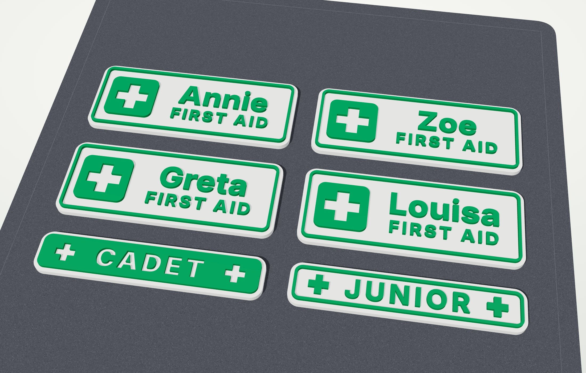

# ✚ First Aid Club badges

These are 3D-printable name badges for Annie, Zoe, Greta and Louisa, plus a tag each for **Cadets** and **Juniors**.
They're white with raised green details, sized for the Bambu Lab A1 mini.

**▶ Preview and downloads: https://dtalic2.github.io/gretas-space/first-aid-badges/**



## Files

| File | What it is |
|---|---|
| [`print/first-aid-badges-plate.3mf`](print/first-aid-badges-plate.3mf) | **Start here.** All six pieces laid out on one 180 × 180 mm plate. |
| `print/badge-<name>.3mf`, `print/tag-<word>.3mf` | One piece per file, for spares or more tags. |
| `print/stl/*.stl` | Each piece as a single solid, for any slicer. |
| [`print/first-aid-badges-files.zip`](print/first-aid-badges-files.zip) | Everything above in one download. |

Each 3MF piece is one object made of two parts. **base** is the white plate, 0–2 mm. **top** is the green details, 2–3 mm.

## Printing on the A1 mini

Use the **0.20mm Standard @BBL A1M** profile on the Textured PEI plate with PLA. The colour changes once, at 2 mm.

**With the AMS lite:**
1. Put white in slot 1 and green in slot 2.
2. Slice, then in the preview drag the layer slider to **layer 11 (2.20 mm)**.
3. Click **+** and choose **Change filament → 2**.

You can instead set each piece's *top* part to filament 2 in the object list.

**Without an AMS:**
1. Slice with white loaded.
2. On **layer 11 (2.20 mm)**, right-click **+** and choose **Add pause**.
3. When the printer pauses, swap to green from the printer's screen and resume.

To print more tags, right-click a piece in Bambu Studio and choose **Clone**.

## Sizes

- Name badge: 76 × 30 × 3 mm
- Cadet and Junior tags: 76 × 15 × 3 mm
- Plastic: the whole set is under 35 g even printed solid, and about 5 g of that is green.

The backs are flat, ready for a stick-on or glued bar pin (25–30 mm) or a 45 × 13 mm magnetic badge back.

The Cadet tag is a solid green bar with white lettering. The Junior tag is white with a green frame and green lettering. Both still print with a single colour change.

The cross is the green-and-white first aid sign (ISO 7010 E003). The red cross on white is a protected emblem under the Geneva Conventions, so it isn't used.

## Making more

The files come from [`tools/make_badges.py`](tools/make_badges.py). Change `NAMES` or `TAGS` at the top of that file, then run:

```
python3 first-aid-badges/tools/make_badges.py
```

It needs Python 3 and HarfBuzz, which draws the lettering (`brew install harfbuzz` on a Mac). The font, Inter ExtraBold, is in [`tools/fonts`](tools/fonts) under the SIL Open Font License, so nothing is downloaded.

A name too long for the badge shrinks to fit. The script checks that every piece is a closed, watertight solid before it writes anything.

To look at the preview page locally, run `python3 -m http.server 8135` in this folder and open http://localhost:8135/.
